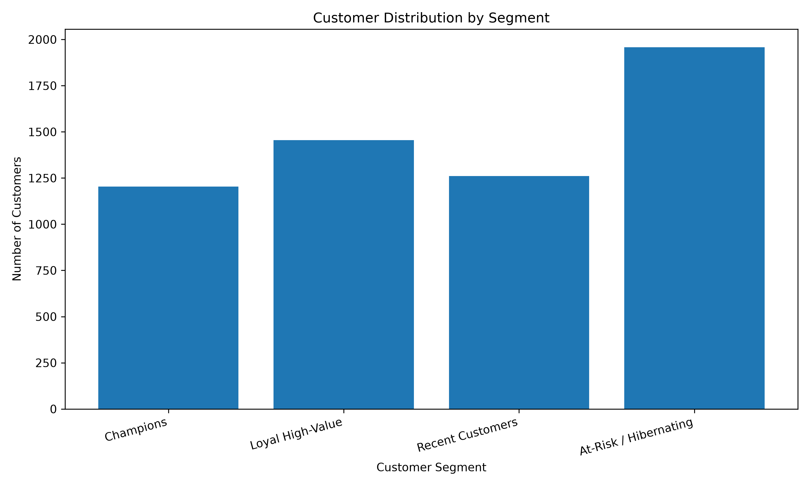
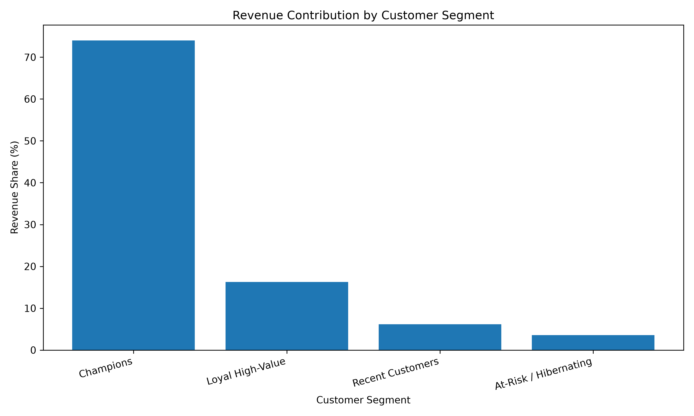
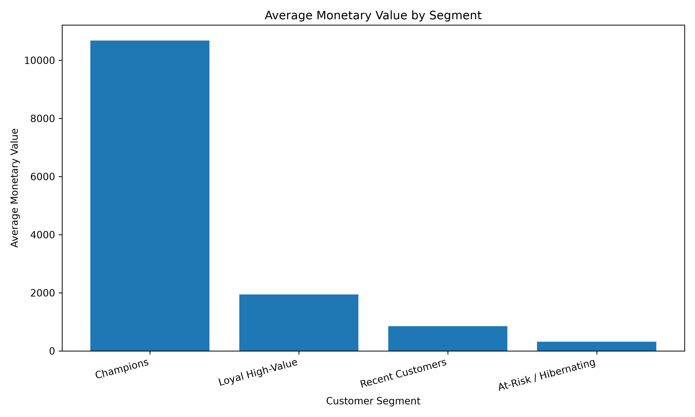

# Customer Segmentation – Business Insights

## 1. Executive Summary

The analysis covers **5,878 customers**, with customer-level RFM monetary value totaling **17,374,804.27**.

The transaction dataset contains **36,969 unique orders**.

The objective is to translate the four RFM customer segments into practical retention, engagement and revenue-growth actions.

## 2. Segment-Level Business Metrics

| Segment | Customers | Customer Share | Revenue | Revenue Share | Avg. Recency | Avg. Frequency | Avg. Monetary |
|---|---:|---:|---:|---:|---:|---:|---:|
| Champions | 1,204 | 20.48% | 12,856,793.52 | 74.00% | 28.44 days | 19.21 | 10,678.40 |
| Loyal High-Value | 1,455 | 24.75% | 2,830,096.17 | 16.29% | 231.20 days | 5.03 | 1,945.08 |
| Recent Customers | 1,261 | 21.45% | 1,069,014.65 | 6.15% | 29.24 days | 3.03 | 847.75 |
| At-Risk / Hibernating | 1,958 | 33.31% | 618,899.93 | 3.56% | 397.89 days | 1.38 | 316.09 |

## 3. Segment-Wise Business Insights

### Champions

- Customers: 1,204 (20.48% of customers)
- Revenue contribution: 12,856,793.52
- Revenue share: 74.00%
- Average recency: 28.44 days
- Average frequency: 19.21 orders
- Average monetary value: 10,678.40
- Customer behaviour: Recent purchasing, highest average frequency and monetary value.
- Recommended strategy: Offer VIP rewards, early product access, referral benefits and exclusive loyalty perks.
- Primary objective: Retain high-value customers and encourage advocacy.

### Loyal High-Value

- Customers: 1,455 (24.75% of customers)
- Revenue contribution: 2,830,096.17
- Revenue share: 16.29%
- Average recency: 231.20 days
- Average frequency: 5.03 orders
- Average monetary value: 1,945.08
- Customer behaviour: Historically valuable customers with lower recent purchasing activity.
- Recommended strategy: Send personalized win-back emails, loyalty reminders and relevant product recommendations.
- Primary objective: Reactivate valuable customers.

### Recent Customers

- Customers: 1,261 (21.45% of customers)
- Revenue contribution: 1,069,014.65
- Revenue share: 6.15%
- Average recency: 29.24 days
- Average frequency: 3.03 orders
- Average monetary value: 847.75
- Customer behaviour: Recently active customers with comparatively lower purchase frequency and spending.
- Recommended strategy: Use welcome campaigns, second-purchase incentives and product recommendations.
- Primary objective: Convert recent buyers into repeat customers.

### At-Risk / Hibernating

- Customers: 1,958 (33.31% of customers)
- Revenue contribution: 618,899.93
- Revenue share: 3.56%
- Average recency: 397.89 days
- Average frequency: 1.38 orders
- Average monetary value: 316.09
- Customer behaviour: Longest time since purchase and lowest average frequency and monetary value.
- Recommended strategy: Test targeted re-engagement campaigns, feedback surveys and carefully controlled discounts.
- Primary objective: Reactivate customers where commercially worthwhile.

## 4. Overall Business Recommendations

1. Protect Champions through loyalty benefits and personalized experiences.
2. Prioritize high-value customer reactivation campaigns for Loyal High-Value customers.
3. Encourage Recent Customers to make a second and third purchase.
4. Test cost-effective re-engagement campaigns for At-Risk / Hibernating customers.
5. Monitor segment size, revenue share and purchasing behaviour over time.
6. Measure campaign performance using repeat purchase rate, reactivation rate and incremental revenue.

## 5. Important Interpretation Notes

- Monetary values are based on the existing cleaned customer transaction data.
- Revenue share is calculated from the sum of customer-level Monetary values.
- Frequency represents the number of distinct invoices in the RFM dataset.
- Average Order Value is calculated using transaction revenue divided by unique invoices in each segment.
- These are descriptive historical findings, not proof that a marketing campaign will cause a particular outcome.
- The RFM snapshot uses the complete available transaction history, with reference date 2011-12-10. It is suitable for descriptive segmentation.
- Do not use this full-history RFM snapshot as historical input for forward-looking churn prediction because it can introduce future-data leakage.
- A churn model requires cutoff-based historical features and a separate future observation window for its target label.

## 6. Visualizations

## 7. Conclusion

The RFM analysis identifies distinct customer groups with different purchasing patterns and business value. Segment-specific retention and engagement strategies can help the business prioritize its marketing efforts. Their effectiveness should be assessed using measured campaign results rather than assumed outcomes.
